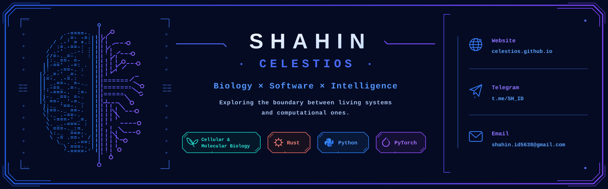

---

  

---

# Hey there, I'm Shahin (Celestios) 👋

I'm a Cellular & Molecular Biology student who fell down the rabbit hole of building software. 

I didn't study computer science, and I don't consider myself a career programmer—I just really love figuring out how complex systems work and building things from scratch. Right around the time I started learning to code, AI tools came along and I adapted to them early. That means I probably skipped some textbook CS rules along the way (and might never learn all of them!), but it let me jump straight into the deep end: experimenting, breaking things, and turning ideas into real software.

---

### 🚀 Things I've Built

#### 🧠 **Centrode** *(Launching in a few days!)*
> *The Central Hub for Your Life — because your life isn't scattered, your tools are.*
* **The Idea:** Digital life is a mess of disconnected bookmarks, notes, tasks, and open tabs[cite: 1]. Centrode brings everything—your knowledge, tasks, habits, and projects—into one connected visual environment that combines the speed of a mind map with the structure of a graph[cite: 1].
* **How it's built:** Powered by a fast **Rust** backend and a natively compiled frontend. Unlike most modern desktop apps, it has **zero dependency on npm or heavy browser engines (no Electron!)**, keeping it lightweight and snappy.
* **The Journey:** This is the project where I truly learned what happens under the hood of an application—software architecture, design patterns, engineering trade-offs, and just how many hidden layers it takes to make something feel simple.

#### 📈 **Holistic Market Autopilot** *(My Pre-AI Era Project)*
* **The Concept:** Before AI coding assistants existed, I wanted to build a complete, end-to-end concept of how an AI could trade the market autonomously.
* **The Real-Time Pipeline:** It connected to live market APIs, cleaned the data, engineered features, and used PyTorch tensor unfolding to slice continuous time-series streams into 3D sliding-window batches. Every 15 hours, it retrained on fresh market data to predict movements (using a custom distance-weighted similarity loss) and manage orders automatically.
* **Dynamic Architecture Compiler (`ModuleChainBuilder`):** Because I was running massive hyperparameter sweeps in **Weights & Biases** across **CNN, TCN, LSTM, Multi-Head Attention, and Transformer** blocks, rewriting PyTorch models by hand was too slow. So I built a string-driven neural network compiler:
  * I could pass shorthand strings defining the block sequence (`cnn`, `tcn`, `lstm`, `trnsE`, `dns`), channel scaling rules, and activation/dropout rates.
  * **Auto-Shape & Axis Resolution:** In PyTorch, CNNs expect `[Batch, Features, Time]` (`NES`) while LSTMs and Transformers expect `[Batch, Time, Features]` (`NSE`). My builder tracked the 3D tensor state across the chain and automatically injected `Permute` and `Flatten` layers, adjusted Transformer attention head divisibility, and interleaved `BatchNorm` and `Dropout` on the fly.
* **The Verdict:** Did it beat the market reliably enough for live trading? Nope! 😄 But building a self-assembling deep learning pipeline from scratch using PyTorch, PyTorch Lightning, Lion/AdamW optimizers, pandas, NumPy, and W&B was an incredible way to learn.

#### 🦠 **University Biology Society Bot**
* Built a full-featured Telegram bot for the biology students at my university.
* It handled student sign-ups, saved member profiles, guided volunteers through translating academic papers and creating content, shared study resources, and kept everyone updated on society events.

---

### 🧭 What Excites Me Next

At the core, I'm fascinated by **brains and thinking systems**—whether they are biological or electrical—and finding the best ways to organize information. Moving forward, I'm exploring two main directions:

* **🕸️ Information Graphs & Thinking Systems:** 
  I love systems programming and graph structures. I'm interested in pushing past current RAG and basic embedding models toward deeper memory systems and cognitive architectures—platforms that help humans (or AI) actually reason about the world, connect philosophy and truth, or map complex biological data.
* **🧬 Bio-Hardware & Embedded Rust:** 
  I see a huge part of the future at the intersection of code and biology. As I go deeper into **Rust**, I want to get closer to the hardware—coding microcontrollers, sensors, and ICs aimed at biological devices.

---

### 🌐 Let's Connect!

  
  

